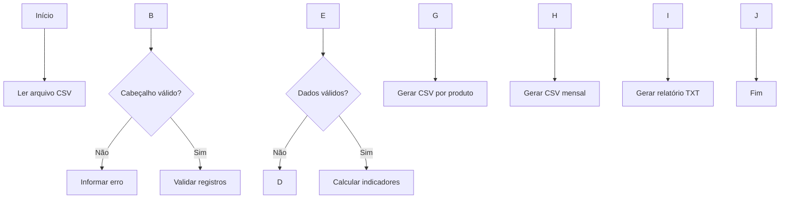

# Documentação técnica — Automação de Relatórios de Vendas

## 1\. Identificação

**Nome:** Automação de Relatórios de Vendas  
**Categoria:** Projeto pessoal de portfólio  
**Linguagem:** Python  
**Nível proposto:** Iniciante  
**Finalidade:** demonstrar fundamentos de programação e processamento de dados tabulares.

## 2\. Problema

A consolidação manual de vendas pode consumir tempo e dificultar a identificação de produtos com maior faturamento e da evolução mensal das receitas. O projeto automatiza a leitura de um arquivo CSV e a produção de relatórios padronizados.

## 3\. Objetivo geral

Construir um programa em Python capaz de importar registros de vendas, validar os dados, calcular indicadores e gerar arquivos de relatório.

## 4\. Requisitos funcionais

|Código|Requisito|
|-|-|
|RF01|Ler um arquivo CSV com os campos obrigatórios.|
|RF02|Validar data, produto, quantidade e preço unitário.|
|RF03|Calcular o total de cada registro.|
|RF04|Calcular faturamento total, unidades e quantidade de registros.|
|RF05|Agrupar quantidade e faturamento por produto.|
|RF06|Agrupar faturamento por mês.|
|RF07|Exportar os resultados em CSV e TXT.|

## 5\. Requisitos não funcionais

|Código|Requisito|
|-|-|
|RNF01|Utilizar nomes de funções e variáveis compreensíveis.|
|RNF02|Utilizar codificação UTF-8 para leitura e escrita.|
|RNF03|Informar erros de validação com o número da linha.|
|RNF04|Não exigir bibliotecas externas nesta versão.|
|RNF05|Manter o código organizado em funções reutilizáveis.|

## 6\. Tecnologias e conceitos aplicados

* Python: linguagem principal.
* `csv`: leitura e escrita de arquivos tabulares.
* `collections.defaultdict`: agrupamento de dados.
* `datetime`: validação e agrupamento de datas.
* `pathlib`: manipulação de caminhos.
* `unittest`: testes automatizados.

Conceitos praticados: variáveis, tipos de dados, condicionais, laços, funções, listas, dicionários, exceções e manipulação de arquivos.

## 7\. Fluxo de processamento

1. O programa localiza o arquivo `dados/vendas\_exemplo.csv`.
2. Confere a existência das colunas obrigatórias.
3. Percorre cada registro e valida os campos.
4. Calcula o total de cada linha: quantidade × preço unitário.
5. Consolida os indicadores gerais e agrupamentos.
6. Cria a pasta de saída, se necessário.
7. Exporta os relatórios.



## 8\. Regras de validação

* A data deve seguir o padrão `AAAA-MM-DD`.
* O nome do produto não pode estar vazio.
* A quantidade deve ser um inteiro maior que zero.
* O preço unitário não pode ser negativo.
* O cabeçalho deve conter `data`, `produto`, `quantidade` e `preco\_unitario`.

## 9\. Fórmulas

**Total por registro**

`total = quantidade × preco\_unitario`

**Faturamento total**

`faturamento\_total = soma dos totais de todos os registros`

**Ticket médio por registro**

`ticket\_medio = faturamento\_total ÷ quantidade\_de\_registros`

Observação: sem um identificador de pedido, o indicador não representa necessariamente o ticket médio por pedido.

## 10\. Testes

Os testes automatizados cobrem:

* Cálculo dos indicadores.
* Rejeição de arquivo com cabeçalho inválido.
* Criação dos três arquivos de saída.

Comando:

```bash
python -m unittest discover -s tests -v
```

## 11\. Evidências de execução

Após executar `python src/relatorios.py`, verificar a criação de:

* `relatorios/relatorio\_geral.txt`
* `relatorios/resumo\_por\_produto.csv`
* `relatorios/resumo\_mensal.csv`

As evidências visuais devem ser capturadas pelo autor após executar o programa em seu próprio ambiente.

## 12\. Limitações conhecidas

A aplicação usa um arquivo CSV local e não possui banco de dados, interface gráfica ou autenticação. Os valores monetários são representados por `float` nesta versão didática; em uma evolução voltada a operações financeiras rigorosas, recomenda-se utilizar `Decimal`.

## 13\. Melhorias futuras

* Entrada de parâmetros pela linha de comando.
* Importação de múltiplos arquivos.
* Persistência em banco de dados relacional.
* Exportação para Excel e gráficos.
* Identificador de pedido para indicadores por venda.
* Registro de erros em arquivo de log.

## 14\. Declaração de autoria

Maria Clara Rodrigues de Oliveira, https://github.com/mcro28.

